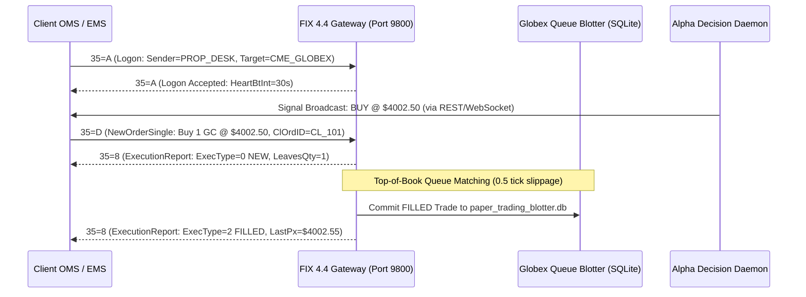

# 🏛️ CME Globex iLink 3 / FIX 4.4 Gateway Specification
## Institutional Order Routing, Queue Positioning & Execution Gateway
**Protocol Standard:** FIX.4.4 / CME iLink 3 SBE Compatible  
**Gateway Engine:** [`scripts/fix_protocol_gateway.py`](file:///home/ayush-pandey/DATABENTO_RESEARCH/scripts/fix_protocol_gateway.py)  
**Port:** `9800` (TCP SOH Delimited)  
**Target CompID:** `CME_GLOBEX`  

---

### 📡 1. Overview & Institutional Architecture
Proprietary trading desks, Commodity Trading Advisors (CTAs), and systematic hedge funds require **FIX protocol connectivity** to execute orders through their existing Order Management Systems (OMS) and Execution Management Systems (EMS) such as Trading Technologies (TT), CQG, or Sierra Chart.

Our FIX gateway provides a standard socket layer that translates institutional FIX messages directly into the **CME Gold Microstructure Blotter** and **Realistic FIFO Queue Simulator**.



---

### 📋 2. Supported FIX Message Schema

| Tag | Tag Name | Type | Allowed Values | Institutional Description |
| :--- | :--- | :--- | :--- | :--- |
| **35** | `MsgType` | String | `A`, `0`, `D`, `F`, `G`, `8`, `9` | Standard FIX message identifier |
| **49** | `SenderCompID` | String | *Custom* | Institutional client identifier (e.g. `PROP_DESK_ALPHA`) |
| **56** | `TargetCompID` | String | `CME_GLOBEX` | Exchange destination identifier |
| **11** | `ClOrdID` | String | *Unique* | Client-assigned unique order ID |
| **37** | `OrderID` | String | *Generated* | Globex exchange assigned order reference |
| **55** | `Symbol` | String | `GC`, `MGC`, `SI` | Instrument symbol identifier |
| **54** | `Side` | Int | `1`=Buy, `2`=Sell | Execution order side |
| **38** | `OrderQty` | Int | $\ge 1$ | Quantity of contracts to execute |
| **44** | `Price` | Float | $> 0.0$ | Limit order price |
| **40** | `OrdType` | String | `1`=Market, `2`=Limit | Execution order type |
| **150**| `ExecType` | Char | `0`=New, `2`=Fill, `4`=Cancel | Execution transaction type |
| **39** | `OrdStatus` | Char | `0`=New, `2`=Filled, `4`=Canceled| Cumulative order state |
| **10** | `CheckSum` | String | 3-digit modulo 256 | Validates frame integrity |

---

### 🧪 3. Client Verification via Command Line
Institutional clients can verify their connection using the built-in test client:
```bash
python3 scripts/fix_protocol_gateway.py --test-client
```
