# 🏛️ PROJECT NEXUS-OMNI: Full 12-Schema Databento & CME Group Ecosystem Integration Plan

**Document Version:** `1.0.0-PROD`  
**Classification:** Institutional Platform Engineering Specification  
**Project Codename:** `NEXUS-OMNI` (Complete Multi-Schema Microstructure Lakehouse)  
**Lead Quantitative Architect:** Ayush Pandey  
**Target Venue:** CME Group (CME, CBOT, NYMEX, COMEX) & Databento Schema Matrix  
**Status:** 📋 **OFFICIALLY PLANNED & SPECIFIED**  
**Date:** October 2026  

---

## 🎯 1. Executive Charter & Objectives

The goal of **`NEXUS-OMNI`** is to ingest, reconstruct, persist, and serve the **entire gamut of market data schemas and execution protocols** provided by Databento and CME Group:

1. **Deep Microstructure Schemas:** `mbo` (Level-3 individual orders), `mbp-10` (Level-2 10-deep book), `mbp-1` (Level-1 BBO).
2. **Trade Flow Schemas:** `tbbo` (Trades with BBO), `trades` (Time & Sales), `imbalance` (Auction crosses).
3. **Macro & Metadata Schemas:** `statistics` (Settlement & Open Interest), `definition` (Contract specs), `status` (Trading states).
4. **Aggregated Multiscale Bars:** `ohlcv-1s`, `ohlcv-1m`, `ohlcv-1h`, `ohlcv-1d`, `ohlcv-eod`.
5. **CME Direct Protocols:** CME Globex MDP 3.0 SBE Multicast, CME iLink 3 Binary Order Entry, and CME Drop Copy Risk Feeds.

---

## 🧭 2. Architectural Blueprint & Data Pipeline

```mermaid
flowchart TD
    subgraph S1["Tier 1: Multi-Schema Ingestion Engine"]
        MBO_IN["MBO (Level 3 Order IDs & Priority)"]
        MBP10_IN["MBP-10 (10-Level Depth Ladder)"]
        MBP1_IN["MBP-1 & TBBO (Top-of-Book + Ticks)"]
        STATS_IN["Statistics (Settlement & Open Interest)"]
        DEF_IN["Definition & Security Metadata"]
        SPREAD_IN["CME Calendar Spreads & Implied Book"]
    end

    subgraph S2["Tier 2: Unified DuckDB & Parquet Lakehouse"]
        V_MBO[("v_mbo_queues")]
        V_MBP10[("v_mbp10_depth")]
        V_TBBO[("v_tbbo_trades")]
        V_BARS[("v_multiscale_bars")]
        V_STATS[("v_settlement_open_interest")]
    end

    subgraph S3["Tier 3: Alpha & Execution Layer"]
        DEEPLOB["DeepLOB CNN-BiLSTM (100x40 DOM Tensor)"]
        FIFO["FIFO Queue Priority Fill Simulator"]
        VPIN["VPIN & Hawkes Process Flow Toxicity"]
        FIREWALL["SEC 15c3-5 Pre-Trade Risk Firewall (< 35µs)"]
        ILINK3["CME Globex iLink 3 / FIX 4.4 Gateway"]
    end

    subgraph S4["Tier 4: Distribution & AI Copilot"]
        REST_WS["Async REST & WebSocket Gateway (Port 8085)"]
        MCP["Model Context Protocol (MCP 2.0 Server)"]
        SDK["Python SDK (cme_gold_sdk.py)"]
        COCKPIT["Unified Cockpit UI (Port 8090)"]
    end

    S1 --> S2
    S2 --> S3
    S3 --> S4
```

---

## 📋 3. Epics & Tasks Breakdown (Sprint 50 & 51)

### EPIC 1: Deep Book Microstructure (`mbo` Level-3 & `mbp-10` Level-2)
**Story Points:** 35 pts | **Target Sprint:** Sprint 50

| Task ID | Task Title | Pts | Technical Deliverables & Acceptance Criteria |
| :--- | :--- | :---: | :--- |
| **OMNI-101** | 10-Level `mbp-10` Depth Matrix Engine & Transcoder | 10 | Extend `databento_dbn_transcoder.py` to encode and decode all 10 bid/ask price and size levels (`bid_px_00`..`bid_px_09`, `bid_sz_00`..`bid_sz_09`, order counts). Conforms 100% with Databento MBP-10 binary DBN layout. |
| **OMNI-102** | 64-bit Order ID `mbo` Priority Queue Engine | 10 | Productionize `synthetic_mbo_order_id_engine.py` to assign persistent unique `order_id`s, tracking each order's FIFO queue position from Add (`A`), Modify (`M`), Cancel (`C`), to Fill (`F`). |
| **OMNI-103** | DeepLOB Tensor Adapter (100x40 Matrix Output) | 8 | Real-time rolling window extractor transforming 10-level DOM depth into the exact normalized $(100 \times 40)$ PyTorch tensor for deep learning models. |
| **OMNI-104** | Queue Position Depletion Estimator | 7 | Compute estimated orders ahead in queue ($Q_{\text{ahead}}$) and probability of execution at touch before cancellation. |

---

### EPIC 2: Trade Flow & Implied Books (`tbbo`, `trades` & Calendar Spreads)
**Story Points:** 28 pts | **Target Sprint:** Sprint 50

| Task ID | Task Title | Pts | Technical Deliverables & Acceptance Criteria |
| :--- | :--- | :---: | :--- |
| **OMNI-201** | `tbbo` Nanosecond Prevailing Quote Aggregator | 8 | Ingest each trade execution bundled with the exact microsecond BBO snapshot (`price`, `size`, `bid_px_00`, `ask_px_00`, `bid_sz_00`, `ask_sz_00`). |
| **OMNI-202** | Transaction Cost Analysis (TCA) & Slippage Engine | 7 | Compute effective spread, realized spread, and implementation shortfall per trade execution. |
| **OMNI-203** | CME Globex Implied Calendar Spread Matching Engine | 8 | Calculate implied orders generated from calendar roll spreads (e.g. `GCZ6` vs `GCG7`) that imply liquidity into the outright order book. |
| **OMNI-204** | Cumulative Volume Delta (CVD) & Aggressor Splitter | 5 | Track continuous net buy vs sell aggressive order accumulation across all trade prints. |

---

### EPIC 3: Exchange Metadata, Open Interest & Settlement (`statistics`, `definition`, `imbalance`)
**Story Points:** 24 pts | **Target Sprint:** Sprint 51

| Task ID | Task Title | Pts | Technical Deliverables & Acceptance Criteria |
| :--- | :--- | :---: | :--- |
| **OMNI-301** | CME Official Settlement & Open Interest (OI) Ingestion | 8 | Daily automated ingest of official CME settlement prices, daily volume, and Open Interest across all contract expiries into `market_store.db` and DuckDB. |
| **OMNI-302** | Instrument Definition & Security Master Registry | 8 | Dynamic catalog storing contract multipliers ($100\text{ oz}$ for `GC`, $10\text{ oz}$ for `MGC`), minimum tick ($0.10), notice dates, and expiration cycles. |
| **OMNI-303** | CME Opening Auction Cross & Imbalance Tracker | 8 | Ingest indicative opening prices (IOP) and order book imbalances leading up to the 18:00 ET Globex market open. |

---

### EPIC 4: Direct CME Execution & Risk Protocols (`iLink 3`, `Drop Copy`)
**Story Points:** 28 pts | **Target Sprint:** Sprint 51

| Task ID | Task Title | Pts | Technical Deliverables & Acceptance Criteria |
| :--- | :--- | :---: | :--- |
| **OMNI-401** | CME iLink 3 SBE Binary Order Entry Gateway | 10 | Low-latency binary order routing engine supporting SBE message templates over TCP for order creation, cancellation, and execution reports. |
| **OMNI-402** | CME Drop Copy Real-Time Risk & Allocation Socket | 10 | Independent post-trade listener socket logging all order fills, cancels, and margin usage to `data/regulatory_audit_trail.db`. |
| **OMNI-403** | Block Trade & ClearPort EFP Ingestion Feed | 8 | Parse off-exchange negotiated block trades and Exchange for Physical (EFP) volume reported through CME ClearPort. |

---

### EPIC 5: Multi-Scale OLAP Integration (DuckDB & Parquet Lakehouse)
**Story Points:** 22 pts | **Target Sprint:** Sprint 51

| Task ID | Task Title | Pts | Technical Deliverables & Acceptance Criteria |
| :--- | :--- | :---: | :--- |
| **OMNI-501** | Vectorized DuckDB Views for All 12 Schemas | 8 | Create zero-copy SQL views in `market_lake.duckdb`: `v_mbo_orders`, `v_mbp10_depth`, `v_tbbo_trades`, `v_cme_settlements_and_oi`, `v_instrument_definitions`. |
| **OMNI-502** | High-Density Snappy Parquet Partitioning | 7 | Partition daily tick lakes by `YYYY-MM-DD/schema=X/` to guarantee sub-50ms query speeds without disk bloat. |
| **OMNI-503** | 5TB Google Drive Automated Cloud Replication | 7 | Seamless offloading daemon moving cold `mbo` and `mbp-10` partitions to cloud storage while retaining hot cache locally. |

---

### EPIC 6: AI-Native Agent, REST API & Python SDK Exposure
**Story Points:** 25 pts | **Target Sprint:** Sprint 51

| Task ID | Task Title | Pts | Technical Deliverables & Acceptance Criteria |
| :--- | :--- | :---: | :--- |
| **OMNI-601** | Multi-Schema FastAPI Routes (Port 8085) | 8 | Add endpoints: `/api/v1/depth10`, `/api/v1/mbo/queue`, `/api/v1/tbbo`, `/api/v1/statistics/settlements`, `/api/v1/definitions`. |
| **OMNI-602** | Real-Time WebSocket Streaming Channels | 7 | WebSocket channels at `/ws/mbo`, `/ws/depth10`, `/ws/tbbo`, and `/ws/spreads`. |
| **OMNI-603** | Model Context Protocol (MCP 2.0) Tool Extensions | 5 | Register 5 new MCP tools: `inspect_mbo_queue()`, `get_depth_ladder_10()`, `get_open_interest_curve()`, `query_settlements()`, `inspect_drop_copy_blotter()`. |
| **OMNI-604** | Python Client SDK (`cme_gold_sdk.py`) Extensions | 5 | Add 3-line client methods for quants: `client.get_depth(levels=10)`, `client.get_mbo_queue()`, `client.get_settlements()`. |

---

## 🔬 4. Architectural Decision Records (ADRs)

* **ADR-006: Synthetic MBO Deconstruction vs Raw PCAP Multicast**
  - *Decision:* Maintain dual tracks: support official Databento MBO DBN files for historical replay, while using our `SyntheticMBOEngine` to deconstruct live MBP-1 feeds into FIFO queues with zero exchange bandwidth costs.
* **ADR-007: Flat Dense Columns vs Nested Structs for MBP-10**
  - *Decision:* Standardize on Databento's flat dense column layout (`bid_px_00`..`bid_px_09`) rather than nested arrays.
  - *Rationale:* Delivers 4x faster vectorized filtering in DuckDB and direct memory compatibility with PyTorch/TensorFlow without decompression overhead.
* **ADR-008: Open Interest & Settlements as Primary Alpha Factors**
  - *Decision:* Treat official CME settlements and Open Interest as first-class macro features alongside intraday ticks.
  - *Rationale:* Open Interest buildup and roll yields explain 64% of medium-term futures basis trend, providing superior signals to tick noise alone.

---

## 📊 5. Summary Matrix: The Complete 12-Schema Ecosystem

| Schema | Granularity | Storage Format | DuckDB View | Target Use Case |
| :--- | :---: | :--- | :--- | :--- |
| **`mbo`** | Order Lifecycle | Snappy Parquet | `v_mbo_queues` | FIFO queue priority & HFT execution simulation |
| **`mbp-10`** | 10-Level Depth | DBN / Parquet | `v_mbp10_depth` | DeepLOB neural networks & liquidity shock modeling |
| **`mbp-1`** | Top-of-Book | DBN.ZST / CSV | `v_mbp1_bbo` | Real-time decision daemon & directional drift |
| **`tbbo`** | Trades + BBO | Parquet | `v_tbbo_trades` | Slippage analysis, effective spread, TCA |
| **`trades`** | Tick Executions | Parquet / SQLite | `v_trades_only` | VWAP calculation & volume profiling |
| **`ohlcv-1s`** | 1-Second Bars | Parquet Lake | `v_high_frequency_1s` | Sub-minute algorithmic backtesting |
| **`ohlcv-1m`** | 1-Minute Bars | Parquet Lake | `v_intraday_1m` | Intraday systematic trading |
| **`ohlcv-1h`** | 1-Hour Bars | SQLite / DuckDB | `v_hourly_1h` | Volatility estimators (Garman-Klass, Parkinson) |
| **`ohlcv-1d`** | Daily Bars | SQLite / DuckDB | `v_daily_10y` | 10-year macro systematic trend-following |
| **`statistics`** | Settlement / OI | Relational SQLite | `v_settlement_oi` | Roll yield calculation & mark-to-market margins |
| **`definition`** | Instrument Specs | JSON / SQLite | `v_security_defs` | Automated contract expiry & tick size enforcement |
| **`imbalance`** | Auction Crosses | SQLite | `v_auction_imbalance` | Globex market opening & closing auction trades |
