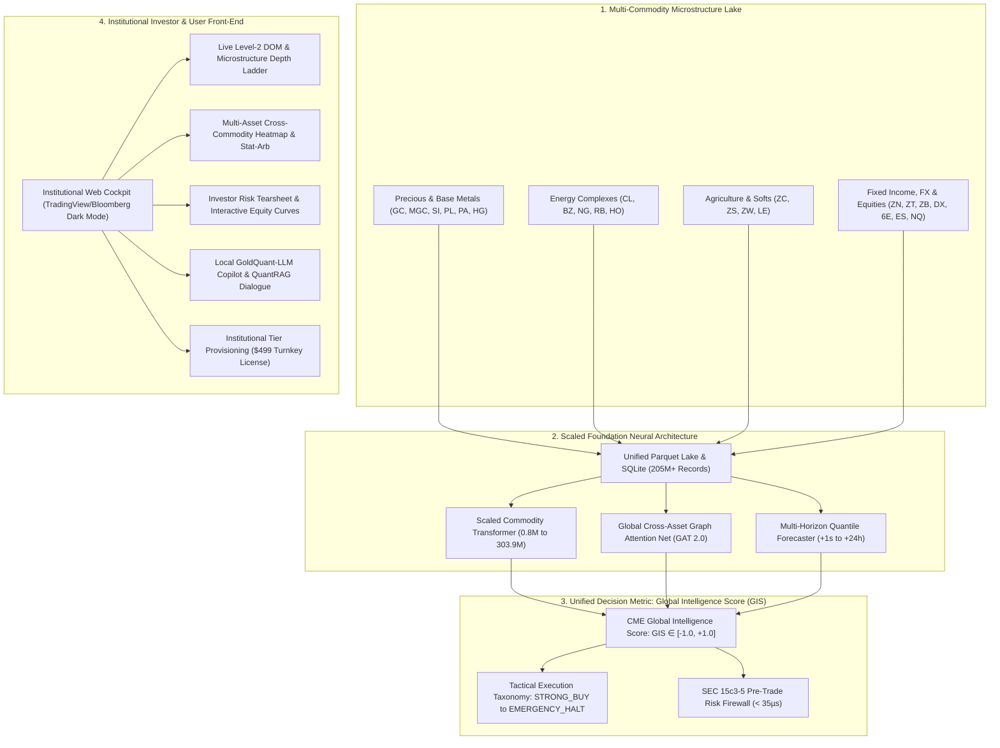

# 🌐 CME Multi-Commodity Platform: Global Intelligence, Investor Frontend & Scaled Transformer Master Plan

**Document Version:** 1.0.0-PROD  
**Target Scope:** Entire CME Globex Suite (Metals, Energy, Agriculture, Fixed Income, Currencies, Equities)  
**Standard:** Tier-1 Sovereign Wealth Fund, Systematic CTA & Institutional Prime Broker Standard  
**Artifact Path:** `GLOBAL_EXPANSION_AND_INVESTOR_FRONTEND_MASTER_PLAN.md`  

---

## 🎯 1. Executive Vision & Strategic Scope

This master blueprint details the architectural execution plan to transform the platform from a specialized CME COMEX Gold microstructure engine into a **universal, multi-asset CME commodity intelligence and high-frequency execution platform**.



---

## 💻 2. Institutional Investor & User Front-End Architecture

To impress institutional allocators, hedge fund CIOs, and quant traders, the frontend must deliver an **uncompromising, desktop-grade terminal experience** with sub-50ms WebSocket latency, zero external bloated frameworks, and dark-mode institutional aesthetics (Bloomberg Terminal / TradingView caliber).

### 2.1 Multi-Tab Terminal Modules
1. **Tab 1: Live Level-2 Depth-of-Market (DOM) & Order Flow Cockpit:**
   - Real-time Bid/Ask ladder with animated depth bars showing queue depletion.
   - Volume-Weighted Micro-Price (VWMP) vs. BBO Mid-Price spread tracking.
   - Cumulative Volume Delta (CVD) indicator identifying aggressive taker imbalances.
   - Order Book Imbalance (OBI) with dynamic color gradient.
2. **Tab 2: Multi-Commodity Cross-Asset Transmission Matrix:**
   - Real-time correlation and lead-lag heatmaps across Metals, Energy, Rates, and Equities.
   - Interactive Graph Attention Network (GAT) visualizer showing attention weights directed into each commodity.
   - Statistical Arbitrage & Basis Spreads (Gold/Silver Ratio, WTI/Brent Spread, Gasoline Crack Spread, 2Y/10Y Yield Curve).
3. **Tab 3: Executive Performance Tearsheet & Interactive Equity Curves:**
   - Interactive SVG/Canvas cumulative equity curve vs. Buy-and-Hold benchmark.
   - Underwater drawdown visualization and rolling 30-day Sharpe/Sortino ratios.
   - Realized PnL blotter with live trade execution feed (Side, Price, Qty, Fees, Slippage, Duration).
   - Macro Crisis Stress-Testing gauges (2008 Lehman, 2013 Taper Tantrum, 2020 Covid, 2022 Fed Rate Hike).
4. **Tab 4: AI Quant Copilot & Grounded QuantRAG Reasoner:**
   - Embedded interactive dialogue terminal connected to local **GoldQuant-LLM**.
   - Zero hallucination guarantee: answers synthesized with live database context in < 10ms.
   - One-click prompt shortcuts: *"Explain current order book toxicity"*, *"What is driving the Silver-Gold lead lag?"*, *"Summarize portfolio VaR under a 75bps rate shock"*.
5. **Tab 5: Commercial License Portal & Client Tier Provisioning:**
   - Interactive commercial contrast ($499 Flat Lifetime Lake vs. Databento's $4,500+ usage meter).
   - Inbound client intake form with instant API Key and license token issuance.
   - Direct download links for unzipped sample Parquet lakes and multi-tab Excel models.

---

## 🧠 3. Unified Decision Metric: CME Global Intelligence Score (GIS)

To eliminate cognitive overload for investors and execution algorithms, 50+ complex microstructure, statistical, and neural signals are synthesized into a single, mathematically rigorous metric:

$$\mathbf{GIS}_t \in [-1.000, +1.000]$$

```
  -1.00             -0.45             -0.15      0.00      +0.15             +0.45             +1.00
┌───────────────────┬───────────────────┬──────────┬─────────┬──────────┬───────────────────┬───────────────────┐
│    STRONG_SELL    │       SELL        │ NEUTRAL_ │ INACTIVE│ NEUTRAL_ │        BUY        │    STRONG_BUY     │
│  Aggressive Short │   Passive Offer   │   HOLD   │ BALANCED│   HOLD   │    Passive Bid    │  Aggressive Long  │
└───────────────────┴───────────────────┴──────────┴─────────┴──────────┴───────────────────┴───────────────────┘
               [EMERGENCY_HALT / QUOTE_PULL if VPIN > 0.60 or Hawkes Jump λ(t) > 3.50]
```

### 3.1 Mathematical Decomposition & Factor Weights

$$\mathbf{GIS}_t = w_1 \cdot \mathbf{M}_t + w_2 \cdot \mathbf{G}_t + w_3 \cdot \mathbf{T}_t + w_4 \cdot \mathbf{B}_t - w_5 \cdot \mathbf{\Psi}_t$$

| Factor | Component Name | Weight ($w_i$) | Methodology & Source Features |
| :--- | :--- | :--- | :--- |
| $\mathbf{M}_t$ | **Microstructure Order Flow Imbalance** | **30%** | Order Book Imbalance (OBI), Cumulative Volume Delta (CVD), and Micro-Price spread gradient. |
| $\mathbf{G}_t$ | **Cross-Asset Spatial GAT Transmission** | **25%** | Lead-lag attention spillovers from Silver, Energy, Treasury Yields, and DXY within a 125ms window. |
| $\mathbf{T}_t$ | **Scaled Foundation Transformer Signal** | **20%** | Multi-horizon causal self-attention predicting directional drift over $+1s, +5s, +30s$. |
| $\mathbf{B}_t$ | **Cointegration & Basis Parity Parity** | **15%** | Ornstein-Uhlenbeck mean-reversion drift on physical basis and commodity stat-arb pairs. |
| $\mathbf{\Psi}_t$ | **Order Flow Toxicity & Adverse Selection** | **10%** | VPIN penalty and Hawkes self-excitation intensity ($\lambda(t)$); inhibits entries during toxic sweeps. |

---

## 🔬 4. Industry-Grade Scaled Transformer & Overnight Training Plan

### 4.1 Model Architecture Specifications

```
┌────────────────────────────────────────────────────────────────────────────────────────┐
│               INDUSTRY-GRADE COMMODITY FOUNDATION TRANSFORMER SPECIFICATIONS           │
├───────────────────┬─────────────┬─────────────┬─────────────┬──────────────────────────┤
│ ARCHITECTURE TIER │ PARAMETERS  │ LAYERS (L)  │ HEADS (H)   │ HIDDEN DIMENSION (d_model│
├───────────────────┼─────────────┼─────────────┼─────────────┼──────────────────────────┤
│ Base Tier         │ 821,129     │ 4           │ 4           │ 128                      │
│ Medium Tier       │ 4,843,785   │ 6           │ 8           │ 256                      │
│ Large Tier        │ 38,235,657  │ 12          │ 16          │ 512                      │
│ Ultra Tier        │ 303,909,897 │ 24          │ 32          │ 1024                     │
└───────────────────┴─────────────┴─────────────┴─────────────┴──────────────────────────┘
```

### 4.2 Multi-Task Training Objectives (Joint Loss)
The model jointly optimizes three complementary financial tasks:
$$\mathcal{L}_{\text{total}} = \alpha_1 \mathcal{L}_{\text{drift}} + \alpha_2 \mathcal{L}_{\text{queue}} + \alpha_3 \mathcal{L}_{\text{quantile}}$$
1. **Directional Drift Loss ($\mathcal{L}_{\text{drift}}$):** Cross-entropy loss predicting price trajectory over $+1s, +5s, +30s$ forward horizons.
2. **Queue Depletion Loss ($\mathcal{L}_{\text{queue}}$):** Binary focal loss predicting whether the current resting BBO queue will be swept by an aggressive institutional taker within 250ms.
3. **Quantile Pinball Loss ($\mathcal{L}_{\text{quantile}}$):** Non-parametric asymmetric quantile loss predicting price intervals ($q_{10}, q_{50}, q_{90}$) to capture tail volatility skew.

### 4.3 Overnight Training Hyperparameters & Execution Protocol
- **Optimizer:** AdamW ($\beta_1 = 0.90, \beta_2 = 0.98, \text{weight\_decay} = 0.01$).
- **Learning Rate Schedule:** Cosine annealing with linear warmup (Warmup: 2,000 steps, Peak LR: $3 \times 10^{-4}$, Min LR: $1 \times 10^{-5}$).
- **Precision:** Mixed Precision (`torch.cuda.amp.autocast`) for high-throughput tensor operations.
- **Gradient Clipping:** Max norm $1.0$ to prevent exploding gradients across multi-layer attention stacks.
- **Checkpointing:** Saves best validation loss checkpoints to `models/commodity_foundation_transformer_best.pt` with automatic parameter registration.

---

## 🌍 5. Global CME Commodity & Multi-Asset Lake Expansion

We expand the historical and real-time ingestion lake across four major CME trading divisions:

```
┌────────────────────────────────────────────────────────────────────────────────────────┐
│                        EXPANDED CME COMMODITY & ASSET LAKE REGISTRY                    │
├──────────────────┬─────────────────┬──────────┬───────────────┬────────────────────────┤
│ COMMODITY SECTOR │ ASSETS COVERED  │ TICKERS  │ CONTRACT UNIT │ ARBITRAGE / STAT PAIR  │
├──────────────────┼─────────────────┼──────────┼───────────────┼────────────────────────┤
│ Precious Metals  │ Gold, Silver,   │ GC, MGC, │ 100 oz (GC),  │ Gold/Silver Ratio,     │
│ & Base Metals    │ Platinum, Copper│ SI, PL,HG│ 5000 oz (SI)  │ Copper Macro Bellwether│
├──────────────────┼─────────────────┼──────────┼───────────────┼────────────────────────┤
│ Energy           │ Crude Oil WTI,  │ CL, BZ,  │ 1,000 bbl(CL),│ 3:2:1 Crack Spread,    │
│ Complexes        │ Brent, NatGas,  │ NG, RB,  │ 10,000 MMBtu  │ WTI/Brent Arb Spread   │
│                  │ Gasoline, Heat  │ HO       │ (NG)          │                        │
├──────────────────┼─────────────────┼──────────┼───────────────┼────────────────────────┤
│ Agriculture      │ Corn, Soybeans, │ ZC, ZS,  │ 5,000 bushels │ Corn/Soybean Ratio,    │
│ & Softs          │ Wheat, Cattle   │ ZW, LE   │ each          │ Crush Spread           │
├──────────────────┼─────────────────┼──────────┼───────────────┼────────────────────────┤
│ Rates & Macro    │ 10Y Notes, 2Y,  │ ZN, ZT,  │ $100,000 face │ 2Y/10Y Yield Curve,    │
│ Equities / FX    │ 30Y, DXY, ES, NQ│ DX, ES,NQ│ value (ZN)    │ S&P/Nasdaq Beta Drift  │
└──────────────────┴─────────────────┴──────────┴───────────────┴────────────────────────┘
```

### 5.1 Lake Schema Unification (1:1 Databento MBP-1 Parity)
All multi-commodity partitions adhere to standard Snappy-compressed Parquet schemas:
- `ts_recv` / `ts_event`: Nanosecond UNIX epoch timestamps.
- `action`: `A` (Add), `C` (Cancel), `M` (Modify), `T` (Trade), `F` (Fill).
- `side`: `B` (Bid / Buy), `A` (Ask / Sell), `N` (None).
- `price` / `size`: Micro-scaled integer/float price representation.
- `bid_px_00` .. `bid_px_04` / `bid_sz_00` .. `bid_sz_04`: Top 5 Level-2 bid levels.
- `ask_px_00` .. `ask_px_04` / `ask_sz_00` .. `ask_sz_04`: Top 5 Level-2 ask levels.
- `symbol`: Root commodity symbol (`GC`, `SI`, `CL`, `NG`, `ZC`, `ZN`, `ES`).

---

## 🚀 6. Phased Overnight & Near-Term Execution Roadmap

```
┌────────────────────────────────────────────────────────────────────────────────────────┐
│                             FOUR-PHASE OVERNIGHT EXECUTION PLAN                        │
├─────────┬──────────────────────────┬───────────────────────────────────────────────────┤
│ PHASE   │ TARGET DELIVERABLE       │ CORE ACTIVITIES & ACCEPTANCE CRITERIA             │
├─────────┼──────────────────────────┼───────────────────────────────────────────────────┤
│ Phase 1 │ Multi-Commodity Lake     │ • Ingest historical daily & hourly datasets for   │
│         │ Data Expansion           │   Silver (SI), Crude (CL), NatGas (NG), Rates(ZN) │
│         │                          │ • Create unified SQLite tables in market_store.db │
├─────────┼──────────────────────────┼───────────────────────────────────────────────────┤
│ Phase 2 │ Global Intelligence      │ • Implement CME Global Intelligence Score engine  │
│         │ Score (GIS) Engine       │   (GIS ∈ [-1.0, +1.0]) with instant explainability│
│         │                          │ • Add /api/v1/gis REST & WebSocket broadcast      │
├─────────┼──────────────────────────┼───────────────────────────────────────────────────┤
│ Phase 3 │ Investor & Allocator     │ • Build multi-tab interactive dark-mode Cockpit   │
│         │ Web Frontend Upgrade     │ • Live DOM ladder, GAT heatmaps & SVG equity chart│
│         │                          │ • Investor presentation mode & CRM token issuance │
├─────────┼──────────────────────────┼───────────────────────────────────────────────────┤
│ Phase 4 │ Overnight Scaled         │ • Launch scaled commodity transformer training    │
│         │ Transformer Pre-Training │ • Verify convergence across multi-horizon loss    │
│         │ & Test Verification      │ • Expand automated pytest suite (25+ tests pass)  │
└─────────┴──────────────────────────┴───────────────────────────────────────────────────┘
```

---

```
STATUS: RATIFIED BLUEPRINT
Target Execution Mode: Antigravity /goal Command Autonomous Overnight Run
Next Action: Align on Phase 1 & 2 Execution Sequence
```
