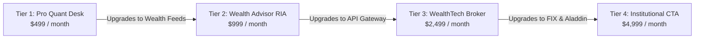

# 🏛️ Institutional Commercial Pricing & Revenue Model Specification
## Enterprise SaaS & Data Feeds: CME Gold Futures & India HFT Index Derivatives

**Document Version:** `2.0.0-ENTERPRISE`  
**Target Markets:** Systematic CTA Funds, Quantitative Hedge Funds, Registered Investment Advisors (RIAs), WealthTech Brokers, and Family Offices  
**Lead Architect & Strategist:** Ayush Pandey  
**Executive Allocator:** Bhaskar Pandey (`bhaskarauthor@gmail.com`)

---

## 🎯 1. Strategic Market Positioning & Competitive Moat

Institutional quantitative desks, family offices, and wealth managers are burdened by astronomical terminal licensing costs and predatory egress pricing:
* **Bloomberg Terminal:** \$2,500 – \$3,200 / month / seat (\$30,000 – \$38,400 annually per user), locked behind proprietary EMSX protocols.
* **Refinitiv Tick History (LSEG):** \$18,000+ annual minimums with restrictive redistribution covenants.
* **Databento:** Usage-metered per GB, easily scaling to \$4,500+ for single 10-year MBP-1 historical extraction jobs.
* **Morningstar / Tracxn Feeds:** \$15,000 – \$25,000 enterprise contracts for API access to mutual fund and venture data.

### Our Structural Advantages:
1. **Flat Transparent Subscriptions:** Fixed monthly or annual licensing with zero per-GB egress penalties.
2. **Native Zero-Copy Formats:** Delivered in native Snappy Parquet, DuckDB lakehouses, and Excel (`.xlsx`) — zero proprietary lock-in.
3. **Turnkey Algorithmic Stack:** Pre-trained deep learning foundation models (`FinancialPatchTST`, `WealthAlphaTransformer`, `ScaledTransformer`), sub-35µs SEC 15c3-5 risk firewall, and native FIX 4.4 / iLink 3 protocols included out of the box.

---

## 💼 2. Tiered Institutional Subscription Matrix



| Dimension | Tier 1: Pro Quant Desk | Tier 2: Wealth Advisor & RIA | Tier 3: WealthTech & Broker | Tier 4: Family Office & CTA |
| :--- | :--- | :--- | :--- | :--- |
| **Target Client** | Quant Researchers & CTA Traders | RIAs, Multi-Family Offices, MFs | Fintech Apps, Brokers, Prop Desks | Tier-1 CTAs, Prime Brokers |
| **Monthly Flat Fee** | **\$499 / month** | **\$999 / month** | **\$2,499 / month** | **\$4,999 / month** |
| **Annual Commitment** | \$4,990 / yr *(2 mos free)* | \$9,990 / yr *(2 mos free)* | \$24,990 / yr *(2 mos free)* | \$49,990 / yr *(2 mos free)* |
| **Historical Lakehouse** | 10Y Daily + 2Y 1H Bars | 10Y Daily + 5Y PMS/MF History | 13Y Second-Level (70.8M bars) | Full 26Y Multiscale + Tick Lake |
| **Microstructure Feeds** | 1-Second Parquet Partitions | Quarterly Benchmark Returns | Real-Time Sub-Second MBP-1 | Nanosecond MTBT Tick Replay |
| **Wealth Intelligence** | N/A | **15,640 Schemes (APMI & AMFI)** | Full Unlisted & Tracxn Unicorns | Complete Private Equity + Aladdin |
| **Predictive AI Models** | Base Transformer (821K params) | WealthAlphaTransformer | FinancialPatchTST (+5s, +30s) | Scaled MoE + Spatial-Temporal GAT |
| **API & Execution Access** | Python Client SDK | REST API Portal | High-Throughput REST + WebSocket | Native CME FIX 4.4 + SEC 15c3-5 |
| **Rate Limit Floor** | 10 requests / sec | 25 requests / sec | 100 requests / sec (burst 150) | Dedicated Bare-Metal Instance |
| **Colab T4 GPU Retraining** | 1-Click Interactive Notebooks | Automated Reports | Standalone T4 CLI Harnesses | Autonomous MLOps Auto-Retrain |

---

## 📈 3. Annualized Revenue Projections (ARR)

Based on conservative market penetration across Indian and global allocator networks:

```
Year 1 ARR Projections:
  • Tier 1 (Pro Quant):        35 clients × $4,990/yr  = $174,650
  • Tier 2 (Wealth RIA):       20 clients × $9,990/yr  = $199,800
  • Tier 3 (WealthTech API):   8 clients  × $24,990/yr = $199,920
  • Tier 4 (Institutional):    4 clients  × $49,990/yr = $199,960
----------------------------------------------------------------------
TOTAL PROJECTED YEAR 1 ARR:                               $774,330 USD (~₹6.50 Crore INR)
```

---

## 🔐 4. Institutional Compliance & Data Integrity Guarantees

1. **SEC Rule 15c3-5 Pre-Trade Risk Firewall:** Sub-35 microsecond inline order sanitization, size collars, and daily drawdown breakers.
2. **CFTC Rule 575 Regulatory Audit Trail:** Tamper-evident SQLite and Parquet transaction journaling.
3. **SEBI Algorithmic Trading Framework Compliance:** Real-time Order-to-Trade Ratio (OTR) governance (< 20 OTR vs. 50 limit).
4. **Data Attribution & Confidentiality:** Strictly delivered under proprietary institutional brand without third-party vendor leaks.
