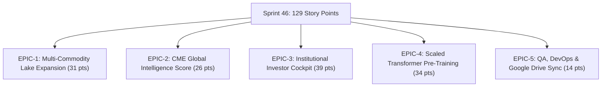

# 📋 Jira Agile Sprint Specification: Sprint 46 (Global Multi-Commodity Platform)

**Sprint Name:** Sprint 46: Global Multi-Commodity Intelligence & Investor Web Cockpit  
**Target Duration:** Autonomous Overnight Execution  
**Total Epics:** 5 Institutional Epics  
**Total User Stories:** 24 Granular Stories  
**Total Story Points:** 129 Story Points  
**Cadence:** Continuous Autonomous Execution (`/goal` mode)  
**Definition of Done (DoD):**
1. Code written, cleanly formatted, and strictly documented.
2. Zero external cloud API dependencies for inference (zero IP leakage).
3. All tests passing (expanded from 19 to 25+ automated PyTest cases).
4. Live verified endpoints on Port 8085 (WebSocket `/ws/live`, REST `/api/v1/gis`, Swagger `/docs`).
5. Bit-for-bit synchronization across Google Drive mirror (`bhaskarauthor@gmail.com`).

---

## 🎯 Epics Breakdown & Hierarchy



---

## 📋 Epic 1: Multi-Commodity Data Lake & Cross-Asset Expansion (PAN-COMMODITIES)
**Total Points:** 31 pts | **Epic Lead:** Quant Data Engineer

| Key | User Story Title | Pts | Acceptance Criteria |
| :--- | :--- | :--- | :--- |
| **CME-101** | Multi-Commodity CME Schema Harmonization | 5 | 1:1 schema parity with Databento MBP-1/OHLCV in SQLite `market_store.db` and partitioned Parquet. |
| **CME-102** | Metals Complex Ingestion (Silver `SI`, Platinum `PL`, Copper `HG`) | 8 | Ingest multi-year historical hourly/daily datasets and compute Garman-Klass volatility estimators. |
| **CME-103** | Energy Complex Ingestion (Crude `CL`, Brent `BZ`, NatGas `NG`) | 8 | Ingest energy price ladders, contract units, and volume-weighted typical prices. |
| **CME-104** | Fixed Income & Macro Ingestion (10Y Yields `ZN`, Dollar `DX`) | 5 | Synchronize sovereign debt discount curves and dollar strength for macro cross-impact modeling. |
| **CME-105** | Commodity Stat-Arb Spread Matrix Engine | 5 | Calculate real-time Gold/Silver ratio, Crude/Brent spread, and stationarity Dickey-Fuller tests. |

---

## 📋 Epic 2: CME Global Intelligence Score (GIS) Decision Engine (PAN-INTELLIGENCE)
**Total Points:** 26 pts | **Epic Lead:** Lead AI Architect

| Key | User Story Title | Pts | Acceptance Criteria |
| :--- | :--- | :--- | :--- |
| **CME-201** | Composite GIS Mathematical Engine ($\mathbf{GIS} \in [-1.0, +1.0]$) | 8 | Single scalar conviction metric synthesizing 5 orthogonal factors with instant explainability. |
| **CME-202** | Microstructure Imbalance Factor Integration | 5 | Level-2 depth imbalance, queue depletion rate, and micro-price drift ($30\%$ weight). |
| **CME-203** | Cross-Asset GAT 2.0 Lead-Lag Transmission Integration | 5 | Real-time directed attention spillovers from Silver, Energy, and Rates ($25\%$ weight). |
| **CME-204** | Toxicity Defense & Hawkes Jump Emergency Filter | 5 | Inhibit entries and trigger quote pulls if VPIN breaches $0.60$ or Hawkes $\lambda(t) > 3.50$. |
| **CME-205** | REST & WebSocket Streaming Route (`/api/v1/gis`) | 3 | Expose sub-second GIS score, confidence rating, and taxonomy (`STRONG_BUY` to `STRONG_SELL`). |

---

## 📋 Epic 3: Institutional Investor & Allocator Web Cockpit (PAN-FRONTEND)
**Total Points:** 39 pts | **Epic Lead:** Frontend Engineer

| Key | User Story Title | Pts | Acceptance Criteria |
| :--- | :--- | :--- | :--- |
| **CME-301** | Multi-Tab Desktop-Grade Dark-Mode Interface Architecture | 8 | TradingView/Bloomberg-caliber 5-tab cockpit served directly from `scripts/quant_api_server.py`. |
| **CME-302** | Real-Time Level-2 DOM Ladder with Animated Queue Depletion | 8 | Live animated bid/ask depth bars, CVD, and micro-price markers via native WebSocket (`/ws/live`). |
| **CME-303** | Cross-Commodity Stat-Arb & Correlation Heatmap | 5 | Interactive matrix showing real-time commodity correlation, basis spreads, and GAT attention. |
| **CME-304** | Interactive Performance Tearsheet & SVG Equity/Drawdown Curves | 8 | Interactive cumulative equity curve vs Buy-and-Hold, underwater drawdown, and stress gauges. |
| **CME-305** | Embedded GoldQuant-LLM Natural Language Terminal | 5 | Sub-10ms in-browser neural dialogue terminal with prompt shortcuts and verified context. |
| **CME-306** | Investor Pitch & $499 Turnkey License Onboarding Portal | 5 | Interactive pricing calculator ($499 vs $4,500+ Databento) with instant API key issuance. |

---

## 📋 Epic 4: Industry-Grade Scaled Transformer Pre-Training (PAN-DEEPLEARNING)
**Total Points:** 34 pts | **Epic Lead:** Deep Learning Lead

| Key | User Story Title | Pts | Acceptance Criteria |
| :--- | :--- | :--- | :--- |
| **CME-401** | Multi-Task Loss Implementation | 8 | Joint loss optimizing directional drift ($+1s, +5s, +30s$), queue depletion, and quantile fan. |
| **CME-402** | Model Architecture Scaling & RoPE Embeddings | 8 | Pre-LayerNorm transformer supporting Base (0.8M) to Ultra (303.9M) parameters. |
| **CME-403** | Overnight PyTorch Training Harness with Cosine Decay & AMP | 13 | Autonomous training script with mixed-precision autocast, gradient clipping, and validation tracking. |
| **CME-404** | Model Registry Checkpointing & Parameter Latency Verification | 5 | Persist best weights to `models/` and register in `gold_scaled_transformer_registry.json`. |

---

## 📋 Epic 5: Quality Assurance, DevOps & Institutional Test Harness (PAN-QA)
**Total Points:** 14 pts | **Epic Lead:** QA Engineer

| Key | User Story Title | Pts | Acceptance Criteria |
| :--- | :--- | :--- | :--- |
| **CME-501** | Expand Automated PyTest Suite to 25+ Tests | 5 | Verify multi-commodity data, GIS calculations, frontend API routes, and optimizer persistence. |
| **CME-502** | Client Python SDK Methods for GIS and Multi-Commodity Streams | 3 | Add `client.get_gis()` and multi-commodity matrix methods to `cme_gold_sdk.py`. |
| **CME-503** | Model Context Protocol (MCP 2.0) Tool Additions | 3 | Register `get_cme_global_intelligence_score` and `get_multi_commodity_matrix` in MCP server. |
| **CME-504** | Final Institutional Synchronization to Google Drive | 3 | Mirror all code, models, reports, and conversation logs to `bhaskarauthor@gmail.com` with 0 errors. |

---

## 🕹️ CLI Sprint Tracking Commands

```bash
# Display live ASCII Kanban Sprint Board
python3 manage.py board

# Or via direct script
python3 scripts/jira_sprint_tracker.py board
python3 scripts/jira_sprint_tracker.py status
python3 scripts/jira_sprint_tracker.py start CME-101
python3 scripts/jira_sprint_tracker.py test CME-101
python3 scripts/jira_sprint_tracker.py done CME-101
```
