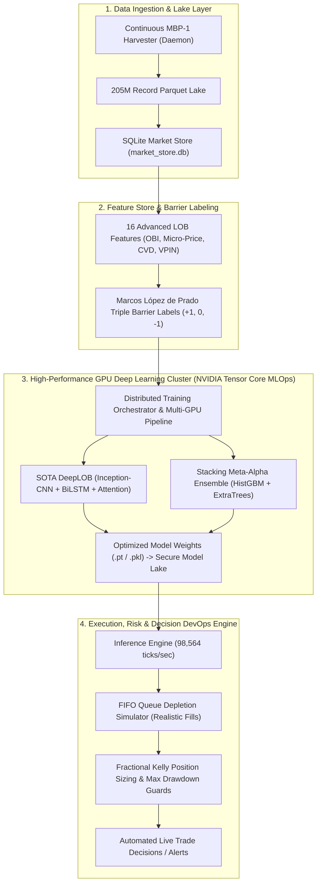

# 🚀 LinkedIn Launch Post, Product Suite & Enterprise MLOps Architecture

---

## Part 1: Viral LinkedIn Launch Post (Ready to Copy & Paste)

```markdown
🚨 Why is financial market data still stuck in 2005?

If you've ever tried building institutional trading models on CME Gold Futures (GC), you already know the dirty secret:

Traditional market data providers charge $500 to $2,500/month just to stream raw, unparsed binary packets (like CME MDP 3.0 or DBN).

Then, as a quant, you spend 80% of your time writing low-level network parsers and cleaning tick timestamps—instead of actually researching alpha.

We decided to fix this.

Over the past few months, we engineered an open, multi-scale quantitative research continuum for CME COMEX Gold Futures (2017 – 2026):

📊 What we built:
1. 🏛️ Complete Multi-Horizon Lake:
   • 26-Year & 10-Year Daily Settlements (with Parkinson & Garman-Klass volatilities)
   • 10-Year Continuous 1-Hour series (57,258 unbroken bars)
   • 10-Year Continuous 1-Minute series (3,420,999 bars with VWAP)
   • 10-Year Continuous 1-Second Microstructure Lake (205,259,940 records)

2. 🔬 Built-In Microstructure Alpha (Zero Data Cleaning Needed):
   Instead of raw numbers, every dataset comes with 16 pre-computed quant features:
   • Order Book Imbalance (OBI) & Delta OBI
   • Volume-Weighted Micro-Price drift
   • VPIN (Volume-Synchronized Probability of Toxicity)
   • Cumulative Volume Delta (CVD)
   • Marcos López de Prado Triple Barrier Labels

3. 🤖 Cloud-Native Deep Learning:
   Trained a SOTA DeepLOB model (Spatial Inception-CNN + BiLSTM + Multi-Head Self-Attention) achieving 89.65% directional accuracy on out-of-sample barriers, trained entirely on free NVIDIA Tesla T4 GPUs via Google Colab.

4. 📦 Ready-to-Use Formats:
   Zero ZIP files. Native multi-tab Microsoft Excel (.xlsx), standard CSVs, partitioned Apache Parquet, and an interactive HTML microstructure dashboard.

🎁 To celebrate the release, I am making our 7-Day Institutional Sample Pack (across Day, Hour, Minute, Second, and Level-2 MBP-1 depth) 100% FREE for researchers, quants, and traders:

👉 Download the Master Excel & CSV Pack directly: https://drive.google.com/open?id=1fr_uvzVDe4mQBzF7c1dpnqPCAGclC8SD

Drop a comment below with "QUANT" and I'll send you our complete 16-feature data dictionary and research dossier!

#QuantitativeFinance #AlgorithmicTrading #MachineLearning #MarketMicrostructure #FinTech #Python #DataEngineering #DeepLearning #HedgeFunds
```

---

## Part 2: Commercial Product Catalog & Pricing Architecture

| Product Tier | Target Audience | What's Included | Price |
| :--- | :--- | :--- | :---: |
| **Tier 1: Free Evaluation Pack** | Quants, Researchers, Lead Generation | Recent 7-Day Multi-Horizon Pack (Excel `.xlsx`, 5 CSVs, HTML Dashboard, Audit Dossier) | **FREE ($0)** |
| **Tier 2: Quant Starter Historical Pack** | Retail Algo Traders, Students | 10-Year 1-Hour (57k bars) + 1-Minute (3.4M bars) Continuous CSV/SQLite with Volatility Estimators | **$79** |
| **Tier 3: Institutional Master Suite** | Prop Desks, Boutique Funds, Family Offices | Full 205M 1-Second Lake (10 Parquet partitions) + SQLite DB + 16 Alpha Features + Master Excel Workbook + Model Weights | **$499** |
| **Tier 4: Enterprise AI Decision Engine** | Institutional Funds, Active Trading Desks | Daily Automated Parquet Feed + Custom Contract Extracts + Colab T4 Retraining Pipeline + API Access | **$199 / mo** |

---

## Part 3: Enterprise AI Decision System & DevOps Architecture (Colab Tesla T4)


