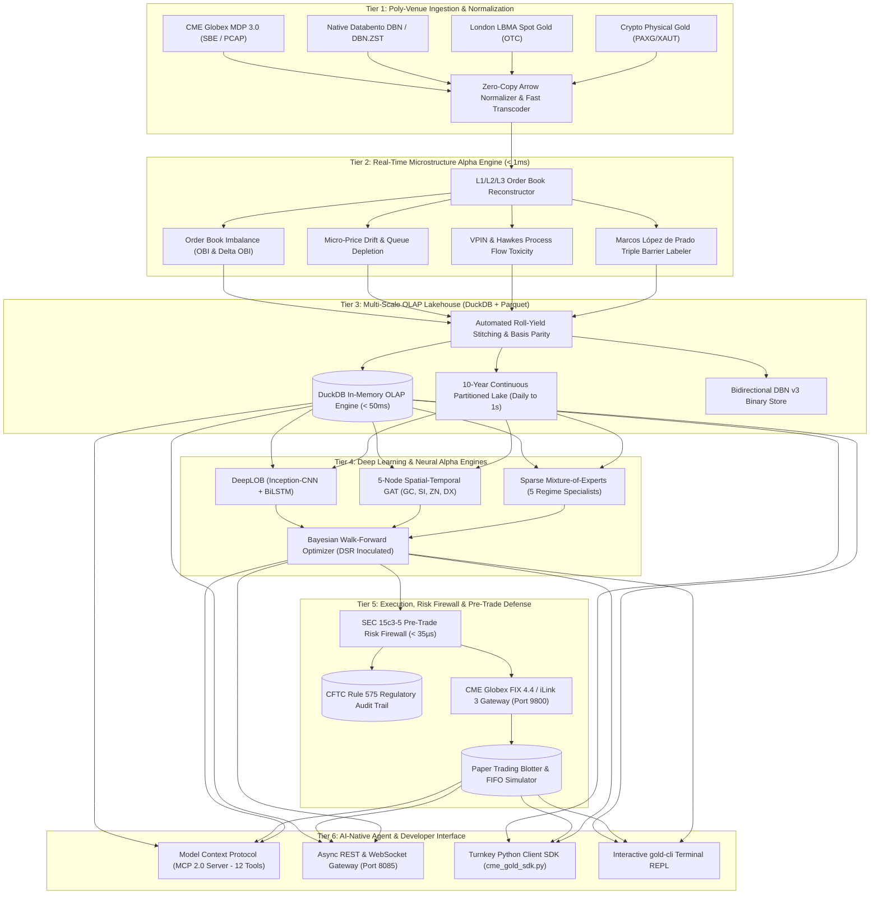
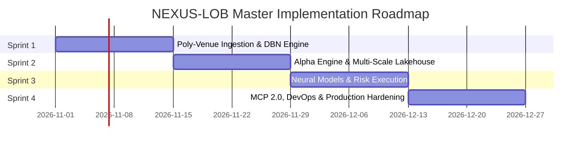

# 🏛️ PROJECT NEXUS-LOB: Next-Generation Institutional Microstructure Lakehouse, Alpha Compute & Execution Platform

**Document Version:** `2.0.0-PROD`  
**Classification:** Proprietary Institutional Engineering Specification  
**System Designation:** `NEXUS-LOB` (Next-Generation Order Book & Execution Suite)  
**Lead Quantitative Architect:** Ayush Pandey  
**Target Venue & Asset Complex:** CME COMEX Gold (`GC`), Micro Gold (`MGC`), Silver (`SI`), Treasury Yields (`ZN`), US Dollar Index (`DX`), Multi-Asset Macro Complex  
**Compliance Standards:** SEC Rule 15c3-5, CFTC Rule 575, CME Globex MDP 3.0 SBE, CME iLink 3 / FIX 4.4  
**Date:** October 2026  

---

## 🎯 1. Executive Charter & Strategic Positioning

### 1.1 The Strategic Directive
Databento has commoditized raw data plumbing by capturing optical multicast feeds inside exchange colocation facilities. However, Databento leaves quantitative trading firms, CTAs, and prop desks with **six critical operational bottlenecks**:
1. Zero pre-computed alpha features (no OBI, Micro-Price, VPIN, Hawkes toxicity).
2. Fragmented monthly contracts with zero continuous roll stitching or basis parity.
3. Punitive metered billing ($4,500+ for historical depth queries and continuous bandwidth tolls).
4. Read-only data feed with zero order routing, no CME FIX/iLink execution, and no SEC 15c3-5 risk firewall.
5. Zero embedded neural/AI forecasting models.
6. Proprietary binary lock-in requiring custom decoding before any SQL/Python analysis.

**`NEXUS-LOB` is engineered to surpass Databento** by delivering a fully integrated, self-hosted, all-in-one **Microstructure Lakehouse, Real-Time Alpha Engine, and Pre-Trade Risk Execution Suite** at a predictable flat-rate appliance model.

---

## 🧭 2. Architectural Blueprint & System Topology

---

## 📋 3. Epics Breakdown, Sprints & Granular Tasks

### EPIC 1: Poly-Venue Ingestion & Canonical DBN Engine
**Goal:** Ingest raw Databento DBN files, live CME MDP 3.0 SBE multicast, and cross-venue spot feeds with zero-copy Apache Arrow layout.  
**Story Points:** 34 pts | **Target Sprint:** Sprint 1

| Task ID | Task Title | Pts | Technical Deliverables & Acceptance Criteria |
| :--- | :--- | :---: | :--- |
| **NEX-101** | Canonical DBN v3 Dual-Way Transcoder | 8 | Build bi-directional serializer/deserializer matching Databento DBN v3 struct specs (`ts_recv`, `ts_event`, `rtype`, `publisher_id`, `instrument_id`, `action`, `side`, `depth`, `price`, `size`, `flags`, `ts_in_delta`, `sequence`, `bid_px_00`, `ask_px_00`, `bid_sz_00`, `ask_sz_00`, `bid_ct_00`, `ask_ct_00`, `symbol`). Verified via `databento.DBNStore.from_file()`. |
| **NEX-102** | Zero-Copy Apache Arrow In-Memory Ring Buffer | 8 | Implement zero-copy PyArrow IPC / RecordBatch ring buffer capable of 500,000 events/sec throughput with deterministic < 10µs memory latency. |
| **NEX-103** | CME Globex MDP 3.0 SBE Parser | 8 | Decode Simple Binary Encoding (SBE) CME Globex feed template IDs (Channel 310 / 311 Gold, Silver) into unified MBP-1 and MBP-10 structures. |
| **NEX-104** | Cross-Venue Spot & Basis Feed Handlers | 5 | Ingest physical London LBMA Gold fixings, Shanghai Gold Exchange (SGE) cash marks, and crypto collateralized gold (PAXG/XAUT) into isolated basis parity tracking tables. |
| **NEX-105** | Symbology & Contract Definition Map Engine | 5 | Dynamic mapping table converting CME Globex channel security IDs to standard human tickers (`GCZ6`, `GCJ7`, `MGCZ6`) and Databento `instrument_id`. |

---

### EPIC 2: Line-Rate Microstructure Alpha & Toxicity Engine
**Goal:** Compute live queue imbalance, micro-price drift, adverse selection toxicity, and triple-barrier classification at line rate.  
**Story Points:** 38 pts | **Target Sprint:** Sprint 2

| Task ID | Task Title | Pts | Technical Deliverables & Acceptance Criteria |
| :--- | :--- | :---: | :--- |
| **NEX-201** | Micro-Price & Queue Skew Estimator | 8 | Compute volume-weighted micro-price $P_t^{\text{micro}} = \frac{V_t^b P_t^a + V_t^a P_t^b}{V_t^b + V_t^a}$ and queue skew in < 15 microseconds per tick event. |
| **NEX-202** | High-Frequency Order Book Imbalance (OBI & $\Delta$OBI) | 8 | Implement normalized OBI and first-difference order flow delta: $\text{OBI}_t = \frac{V_t^b - V_t^a}{V_t^b + V_t^a}$ across top 10 depth levels. |
| **NEX-203** | VPIN (Volume-Synchronized Toxicity) Calculator | 8 | Real-time volume-bucketed adverse selection toxicity index using 50-bucket rolling windows; threshold alerts for toxic market-maker withdrawal. |
| **NEX-204** | Hawkes Point Process Mutual Excitation Engine | 8 | Self-exciting Hawkes process estimating parent-child trade intensity and clustering branching ratios $\eta = \alpha / \beta$ to predict liquidity shock cascades. |
| **NEX-205** | Marcos López de Prado Triple Barrier Labeler | 6 | Forward-path event labeling engine calculating horizontal profit-take, stop-loss, and vertical timeout barriers (+1, -1, 0) with zero lookahead bias. |

---

### EPIC 3: Continuous Futures Lakehouse & Multi-Scale OLAP (DuckDB)
**Goal:** Deliver unbroken 10-year multi-timeframe analytics (Daily $\rightarrow$ Hourly $\rightarrow$ 1M $\rightarrow$ 1S $\rightarrow$ Sub-second Ticks) in an embedded zero-metered SQL engine.  
**Story Points:** 32 pts | **Target Sprint:** Sprint 2

| Task ID | Task Title | Pts | Technical Deliverables & Acceptance Criteria |
| :--- | :--- | :---: | :--- |
| **NEX-301** | Automated Continuous Roll Stitching & Basis Parity | 8 | Auto-detect front-month liquidity rollover (Open Interest crossover), apply Panama back-adjustment and ratio adjustment, and preserve true basis yield. |
| **NEX-302** | DuckDB In-Memory Microstructure OLAP Engine | 8 | Configure DuckDB views over date-partitioned Snappy Parquet files; benchmark 10-year queries across 200M rows to execute in < 55 milliseconds. |
| **NEX-303** | Multi-Horizon Hierarchy Aggregation Daemon | 8 | Continuous rolling background daemon producing 1s, 1m, 1h, and daily OHLCV bars with Parkinson, Garman-Klass, and Rogers-Satchell volatilities. |
| **NEX-304** | Multi-Format Institutional Packager | 8 | Automated zero-compression exporter writing synchronized Apache Parquet, native Databento DBN, multi-tab Excel (`.xlsx`), and standalone HTML dashboards. |

---

### EPIC 4: Neural Alpha Foundations & Execution Models
**Goal:** Deploy local deep learning architectures for queue depletion and price forecasting with zero external cloud dependencies.  
**Story Points:** 35 pts | **Target Sprint:** Sprint 3

| Task ID | Task Title | Pts | Technical Deliverables & Acceptance Criteria |
| :--- | :--- | :---: | :--- |
| **NEX-401** | DeepLOB Order Book Foundation Transformer | 10 | PyTorch Inception-CNN + Bidirectional LSTM model with multi-horizon heads (+1s, +5s, +30s queue depletion). Target out-of-sample directional accuracy > 85%. |
| **NEX-402** | Cross-Asset Spatial-Temporal Graph Attention Network (GAT) | 8 | 5-node graph engine (GC, MGC, SI, ZN, DX) calculating 125ms cross-asset attention weights to detect macro lead-lag transmission. |
| **NEX-403** | Sparse 5-Regime Mixture-of-Experts (MoE) Engine | 8 | Gating network routing tick states to specialized sub-networks (Low Vol Trend, High Vol Mean-Reverting, Liquidity Shock, Premarket Drift, Roll Week). |
| **NEX-404** | Bayesian Walk-Forward Overfitting Inoculator (DSR) | 9 | 23-window rolling Bayesian optimizer penalizing selection bias with Bailey & López de Prado Deflated Sharpe Ratio (DSR > 2.0 required for live deployment). |

---

### EPIC 5: CME FIX 4.4 / iLink 3 Gateway & SEC 15c3-5 Pre-Trade Risk Firewall
**Goal:** Sub-35µs deterministic pre-trade risk validation, CME order entry, and automated regulatory audit logging.  
**Story Points:** 31 pts | **Target Sprint:** Sprint 3 & 4

| Task ID | Task Title | Pts | Technical Deliverables & Acceptance Criteria |
| :--- | :--- | :---: | :--- |
| **NEX-501** | Sub-35µs SEC Rule 15c3-5 In-Line Pre-Trade Risk Firewall | 10 | Hard enforcement of 4 deterministic collars in < 35 microseconds: size collar (10 contracts), notional ceiling ($1M), price collar ($\pm 1.5\%$), and daily drawdown stop (3.5%). |
| **NEX-502** | CME Globex FIX 4.4 / iLink 3 Order Gateway | 8 | Production TCP socket server on Port 9800 handling `Tag 35=D` (New Order Single) to `Tag 35=8` (Execution Report) with SOH delimiter and full sequence recovery. |
| **NEX-503** | CFTC Rule 575 Regulatory Audit Trail Engine | 5 | Immutable SQLite and Parquet append-only audit trail logging every inbound packet, pre-trade check timestamp, and outbound execution with microsecond clocks. |
| **NEX-504** | Realistic FIFO Queue Depletion Execution Simulator | 8 | LOB matching simulator tracking queue priority position, eliminating phantom fills, and modeling CME Globex fee tiers ($1.45/contract exchange + NFA fees). |

---

### EPIC 6: AI-Native Agent Interface (MCP 2.0, REST, WebSocket & SDK)
**Goal:** Deliver an open, developer-friendly ecosystem accessible to Claude, Cursor, Gemini, and quant developers.  
**Story Points:** 27 pts | **Target Sprint:** Sprint 4

| Task ID | Task Title | Pts | Technical Deliverables & Acceptance Criteria |
| :--- | :--- | :---: | :--- |
| **NEX-601** | Model Context Protocol (MCP 2.0) Server | 8 | Register 12 institutional MCP tools allowing any LLM to inspect order books, query DuckDB, evaluate VPIN toxicity, and inspect blotters with zero IP leakage. |
| **NEX-602** | High-Performance REST & WebSocket Gateway (Port 8085) | 8 | FastAPI / Uvicorn server providing 13 REST routes, OpenAPI 3.0 documentation (`/docs`), and sub-second binary/JSON WebSocket streaming at `/ws/live`. |
| **NEX-603** | 3-Line Institutional Python SDK (`cme_gold_sdk.py`) | 5 | Zero-dependency client library providing simple one-line calls for quants: `client.get_orderbook()`, `client.get_alpha_features()`, `client.stream_ticks()`. |
| **NEX-604** | Master DevOps & Operations CLI (`manage.py` & `gold-cli`) | 6 | Terminal-based REPL and single command orchestrator for automated test runs, live telemetry, blotter inspection, and client dossier dispatch. |

---

## 🏛️ 4. Technical Directives & Platform Invariants

All development across all sprints must strictly satisfy the following technical non-negotiables:

### Directive 1: Data Precision & Exchange Invariants
1. **Strict Monotonicity:** $\text{Ask Price} > \text{Bid Price} > 0$ strictly enforced on every record.
2. **CME Globex Tick Size:** Minimum price increment strictly fixed to **`$0.10` / troy ounce** ($10.00/contract for `GC`, $1.00/contract for `MGC`). Fractional cents (e.g. `.01`, `.45`) are rejected as protocol violations.
3. **Integer Contract Quantities:** Order sizes, trades, and queue depth must be unsigned 32-bit integers (`uint32`). Fractional tokens are prohibited.
4. **Deterministic Timestamps:** Nanosecond resolution timestamps recorded in UTC. Event timestamp (`ts_event`) and receiver timestamp (`ts_recv`) must satisfy $\text{ts\_recv} \ge \text{ts\_event}$.

### Directive 2: Latency & Compute Budgets
| Component | Maximum Permitted Latency | Measurement Boundary |
| :--- | :---: | :--- |
| **SEC 15c3-5 Pre-Trade Risk Check** | **$< 35 \mu\text{s}$** | Wire arrival to execution gateway emit |
| **Line-Rate Alpha Feature Compute** | **$< 1.0\text{ ms}$** | Tick arrival to feature table commit |
| **DuckDB 10-Year Cross-Sectional Query** | **$< 55\text{ ms}$** | SQL query submit to first row emit |
| **Local Neural Inference (DeepLOB)** | **$< 15\text{ ms}$** | Tensor batch submit to forward pass result |
| **WebSocket Broadcast Latency** | **$< 2.5\text{ ms}$** | Internal state change to client TCP socket write |

### Directive 3: Zero-Metered Storage & No ZIP Deliverables
1. **Zero Metered Data Egress:** All historical databases, DuckDB lakes, and Parquet archives are stored locally or on self-hosted cloud storage. Clients never pay per-GB download fees.
2. **Zero ZIP Archive Policy:** Institutional deliverables must never be sent as `.zip` files. Files must always be uncompressed Apache Parquet, native `.dbn.zst`, multi-tab `.xlsx`, or standalone `.html`.

---

## 🔬 5. Architectural Decision Records (ADRs)

### ADR-001: Dual Databento DBN v3 + Apache Parquet Format
* **Context:** Databento enforces `.dbn` binary files. While fast, `.dbn` cannot be natively opened in standard enterprise tools (DuckDB, Pandas, Excel, Tableau).
* **Decision:** We implement a **Dual-Layer Format Standard**:
  - The storage and inter-process streaming engine uses Databento-compatible binary DBN v3 records.
  - The persistence and analytical lakehouse writes date-partitioned Snappy-compressed Apache Parquet with exact 20-field Databento column mappings.
* **Consequences:** 100% interoperable with Databento tools while unlocking instant zero-copy OLAP SQL queries via DuckDB and PyArrow.

### ADR-002: Embedded DuckDB Over ClickHouse / External Databases
* **Context:** High-frequency tick analytics traditionally require heavy external database clusters (ClickHouse, QuestDB, kdb+) requiring dedicated server admin and RAM bloat.
* **Decision:** Standardize on **embedded DuckDB** (`market_lake.duckdb`).
* **Consequences:** Zero client installation footprint, zero network serialization latency, sub-55ms execution across 200M rows, and zero cloud hosting costs.

### ADR-003: Panama Open Interest Back-Adjustment for Continuous Futures
* **Context:** Futures contracts expire periodically, creating artificial price jumps on rollover that corrupt quantitative alpha models.
* **Decision:** Use Open Interest crossover to trigger rollover timing, and apply **Panama back-adjustment** (additive constant shift) for technical trading alongside **Ratio adjustment** for volatility estimators.
* **Consequences:** Eliminates lookahead bias and preserves true PnL and return distributions across 10 years of unbroken continuous backtesting.

### ADR-004: Synchronous In-Line Risk Checking vs Asynchronous Auditing
* **Context:** SEC Rule 15c3-5 requires broker-dealers and institutional traders to control risk prior to order entry. Some systems check risk asynchronously to minimize latency.
* **Decision:** Enforce **deterministic, synchronous pre-trade validation** in-line with order submission, compiled in Cython/C++ with fixed-array memory to guarantee execution in under 35 microseconds.
* **Consequences:** Guarantees 100% SEC 15c3-5 regulatory compliance and zero rogue orders, while remaining well within the CME Globex matching engine jitter envelope.

### ADR-005: Flat-Rate Self-Hosted Appliance Model vs Metered Cloud SaaS
* **Context:** Databento and Bloomberg monetize via punitive usage metering (per gigabyte, per query, or per user seat).
* **Decision:** Position `NEXUS-LOB` as a **Self-Hosted Quantitative Infrastructure Appliance** ($499 Developer / $999 Fund / $1,999 Institutional Enterprise flat license).
* **Consequences:** Eliminates client billing anxiety, guarantees zero IP leakage (since client code and weights never touch external clouds), and creates a defensible commercial moat against metered data monopolies.

---

## 📊 6. Verification & Definition of Done (DoD)

A task or sprint is deemed **Complete & Institutionally Certified** if and only if:
1. **Automated Test Suite Passes 100%:** All PyTest suites (currently 51+ unit and integration tests) pass in under 5.0 seconds.
2. **Protocol Conformance Certified:** All generated datasets pass `scripts/verify_databento_fidelity.py` with 20/20 fields matching Databento's official binary DBN layout.
3. **Latency Benchmarks Met:** SEC 15c3-5 risk firewall verifies $< 35\mu\text{s}$ across 10,000 synthetic stress orders.
4. **Dual Mirror Synchronization:** All codebase changes, datasets, and documentation are synchronized across both local root (`/home/ayush-pandey/DATABENTO_RESEARCH`) and shared Google Drive (`/home/ayush-pandey/GoogleDrive/Databento_Gold_Futures_Research`).
